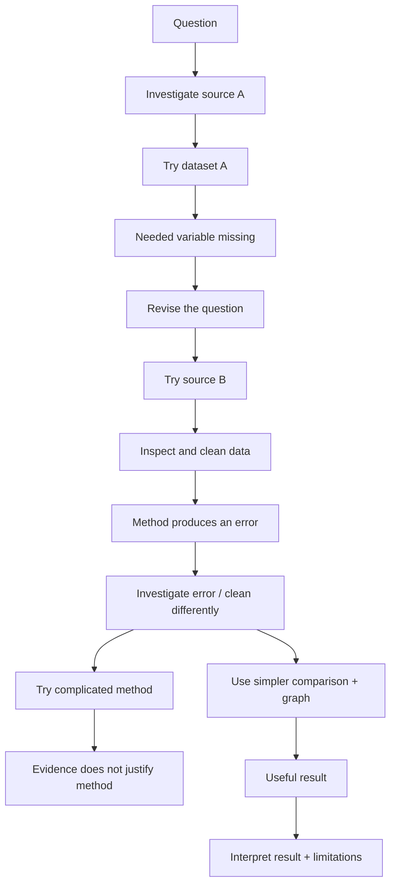

# The Research Tree: Mistakes, Detours, and Decisions

[← Project Journal](05_project_journal.md) · [Next: Interpretation →](07_interpreting_results.md)

Real projects do not move in a perfectly straight line. They branch.

Your team may:

- investigate a source;
- try a dataset;
- discover that an important variable is missing;
- change or narrow the question;
- try a method;
- get an error;
- clean the data differently;
- abandon an approach;
- find a useful result and follow that branch farther.

Those branches are not embarrassing leftovers. They are often the evidence that explains why the final project is reasonable.

## Think of the project as a tree

Text description: the team starts with a question and investigates a source. The first dataset is missing a needed variable, so the team revises the question and tries another source. Later, an error reveals a cleaning problem. A complicated method is attempted but abandoned because the evidence does not justify it. A simpler comparison produces a useful result, which the team interprets with appropriate limitations.

## A failed attempt is not automatically a failed project

A failed experiment, computation, dataset, or method can still strengthen the project when you do five things:

1. **Clearly describe what failed.** State what you expected and what actually happened.
2. **Investigate why.** Check the code, data, assumptions, documentation, sample size, missingness, or method.
3. **Provide evidence.** Show the error message, missing variable, diagnostic plot, row counts, comparison, or other evidence that supports your explanation.
4. **Explain what you learned.** Describe how the failed attempt changed your understanding of the question or data.
5. **Avoid unsupported conclusions.** Do not claim that a method “proved” something merely because another approach failed.

Use this pattern in your journal and report:

**What we tried → What happened → Evidence → What we learned → What we changed**

Example:

> We planned to compare attendance using Source A. After loading the data, we found that the source did not include attendance. The column list and documentation confirmed that no equivalent measure was available. We therefore switched to Source B and recorded that the new source covered a different population and time period.

That is legitimate research progress.

## When code fails

Treat an error as information.

Ask:

1. What line failed?
2. What type of object did Python actually receive?
3. What did I expect?
4. Is the problem code, data, file location, missing values, or an assumption?
5. What is the smallest test that would distinguish those possibilities?

Record a meaningful discovery in the journal. You do not need to preserve every typo.

## When the analysis fails even though the code runs

Sometimes the program runs but the analysis is still inappropriate.

Examples:

- correlation used on a relationship that is clearly nonlinear;
- means compared when one group has a severe outlier and tiny sample;
- regression used without first examining the scatter plot;
- a time trend built from dates that do not represent the event time;
- missing values silently changing the denominator;
- a model used mainly because it sounds advanced rather than because it answers the question.

A program that runs is not automatically a valid analysis.

## Final report: show the larger tree

The final report should document the **larger research tree**. Include meaningful branches when they affected the project, such as:

- sources or datasets considered and rejected;
- missing variables that forced a change;
- important errors that exposed a real problem;
- changes in data cleaning;
- revisions to the question;
- methods tried and abandoned;
- evidence that led to the final method;
- limitations discovered along the way.

Do not turn the report into a diary of every typo. Include the branches that explain important decisions.

The report should make the project honest and reproducible: a reader should understand not only what you finally did, but why you ended up doing it.

## Presentation: follow one clean path

The presentation has a different job. It should follow **one clean path through the tree** so the audience can understand the project within the available time.

A useful presentation path is:

**question → data → method → strongest evidence → conclusion → limitation**

You may briefly mention a failed branch when it explains an important decision, but you do not need to present every source, error message, or abandoned idea.

Think of the distinction this way:

- **Report:** show the important tree.
- **Presentation:** trace the clearest honest path through that tree.

## Beginner checkpoint

Draw your current project tree using boxes, arrows, or indented bullet points. Mark:

- your original question;
- sources/datasets tried;
- one important mistake or failed attempt;
- a decision caused by evidence;
- the branch you are following now;
- the result that currently best answers the question.

Then write:

> We changed **[source/question/cleaning/method]** because **[specific evidence]**. We learned **[lesson]**, so our next step is **[action]**.

Next: [Interpret Results Responsibly](07_interpreting_results.md)
