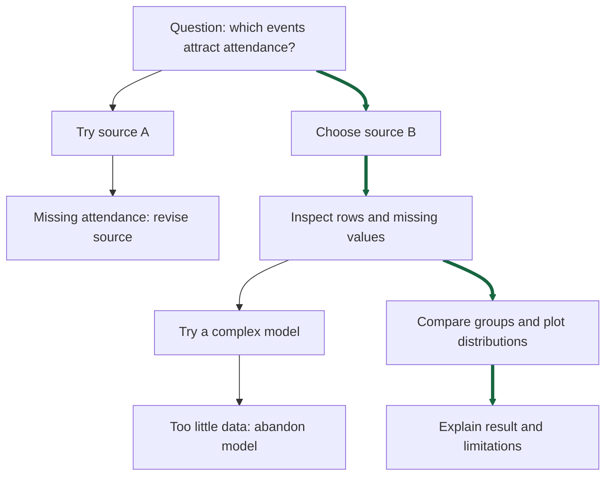

# The research tree: report broadly, present one path

[Capstone home](README.md)

Real projects branch. A discarded dataset, missing variable, or failed method can explain why your eventual analysis is reasonable. A good project does not require the first idea to work.

The example below is fictional. The **thick green route** is the presentation's chosen path; the side branches belong in the report when they changed a decision.

Text description: start with a question. Source A fails because attendance is absent. Source B contains it. After inspection, an attempted complex model proves unsuitable; the team uses a group comparison. The presentation follows **question → source B → inspection → group comparison → result and limitations**. The report also explains why source A and the model were abandoned.

## What belongs in the report?

Include the broader research tree: important sources considered, approaches tried, errors that exposed a conceptual problem, changes to cleaning, and the reasoning behind the final choice. For each meaningful detour, write **what we tried → what happened → what we learned → what changed**. Support the account with your journal and code.

## What belongs in the presentation?

Choose one understandable route through that tree. Introduce the question, explain the data and essential method, show the strongest relevant evidence, and end with the conclusion and limitations. You may briefly mention a detour if it explains a key choice. A coherent presentation does not require pretending there were no mistakes.

## Try it now

List five things your team has tried. Draw arrows showing which led to new questions or decisions. Circle the result that best answers your current question. Trace the shortest honest route a classmate needs to understand that result.
