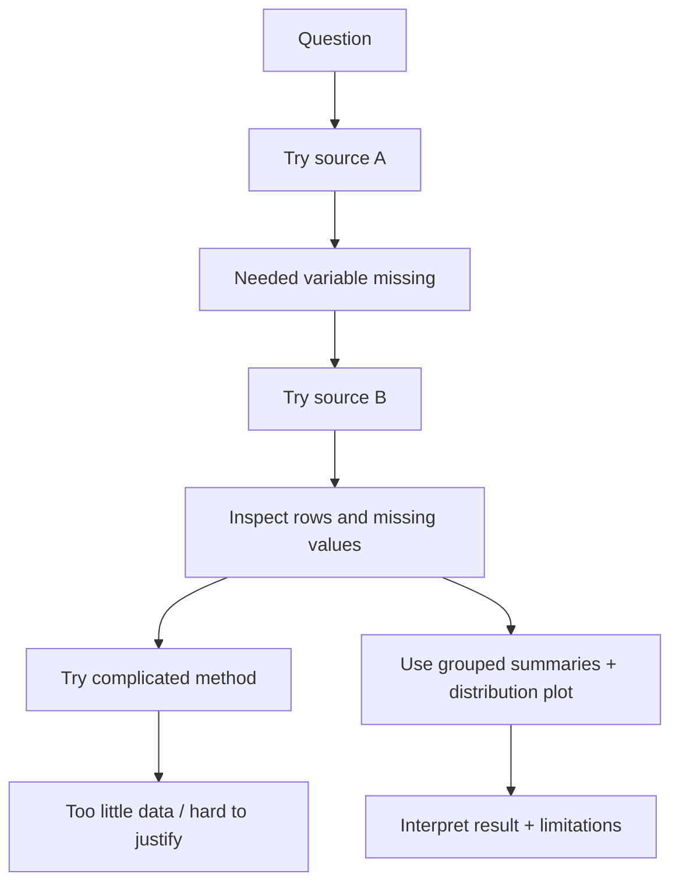

# The Research Tree: Mistakes, Detours, and Decisions

[← Project Journal](05_project_journal.md) · [Next: Interpretation →](07_interpreting_results.md)

Real projects do not move in a perfectly straight line.

You may try a source that fails, discover a missing variable, make a graph that exposes a problem, or abandon a method that is too complicated. Those events are useful when they help you make a better decision.

## A failed attempt is not automatically a failed project

Use this pattern:

**What we tried → What happened → What we learned → What we changed**

Example:

> We planned to compare attendance using Source A. After loading it, we discovered that it did not contain attendance. We therefore switched to Source B and recorded the change in population and time period.

That is a legitimate part of the research process.

## Think of the project as a tree

Text description: the team begins with a question. The first source fails because an important variable is missing. The second source works. After inspection, the team considers a complicated method but decides the data do not justify it. They use grouped summaries and a distribution plot instead, then interpret the result and its limitations.

## What goes in the final report?

Include detours that changed an important decision, such as:

- changing the data source;
- revising the question;
- changing how missing values are handled;
- rejecting an inappropriate method;
- discovering a limitation;
- correcting a conceptual mistake.

Explain the reason for the change.

## What goes in the presentation?

The presentation should usually follow **one clear path**:

**question → data → method → strongest evidence → conclusion → limitation**

You can mention a detour briefly if it explains why the final choice makes sense.

You do not need to present every error message.

## When code fails

Treat the error as information.

Ask:

1. What line failed?
2. What type of object did Python actually receive?
3. What did I expect?
4. Is the problem code, data, file location, missing values, or an assumption?
5. What is the smallest test that would distinguish those possibilities?

Record a meaningful discovery in the journal.

## When the analysis fails

Sometimes the code runs but the analysis is still wrong for the question.

Examples:

- correlation used on a relationship that is clearly nonlinear;
- means compared when one group has a severe outlier and tiny sample;
- regression used without looking at the scatter plot;
- a time trend built from dates that do not represent the event time;
- missing values silently changing the denominator.

A program that runs is not automatically a valid analysis.

## Beginner checkpoint

Draw your current project tree using boxes or bullet points. Circle the branch you are using now.

Then write:

> We changed **[source/question/method]** because **[evidence from the data or computation]**.

Next: [Interpret Results Responsibly](07_interpreting_results.md)
